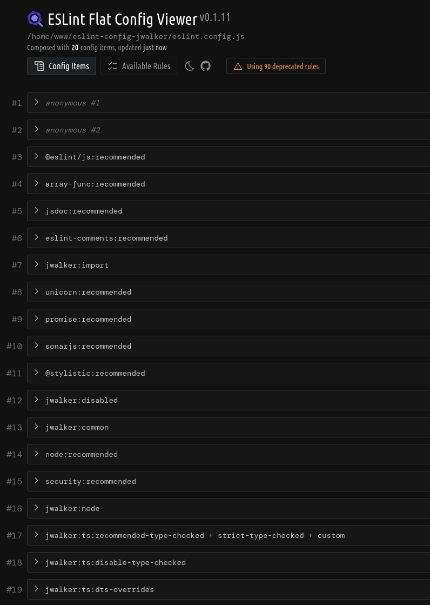

# eslint-config-jwalker

Shareable ESLint config

## Install

```sh
npm i -D eslint-config-jwalker
```

## Usage

```javascript
import {
    node,
    jsonc,
    common,
    disabled,
    formatters,
    typescript,
    defineConfig,
} from 'eslint-config-jwalker'

export default defineConfig([
    ...common,
    ...node,
    ...typescript,
    ...jsonc,
    ...formatters,
    ...disabled,
    {
        rules: {
            // override?
            'import-x/extensions': 'off',
        },
    },
])
```

Spread `disabled` **last** — it turns off rules the upstream presets enable, so anything after it wins.

## Presets + Custom Rules


